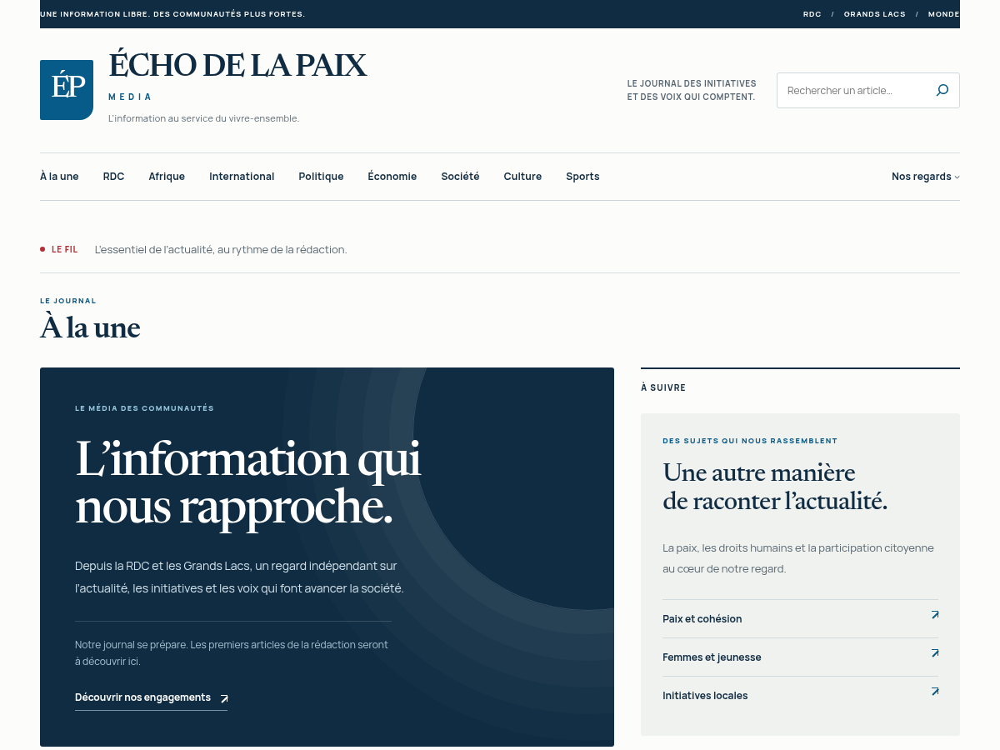

# ECHO DE LA PAIX MEDIA

Thème WordPress à blocs **Echo Paix News 1.1.0** : une éditoriale, typographie locale Newsreader / Manrope, mises en page adaptées au téléphone, rubriques d’actualité et modèles d’articles.

**[Télécharger le thème installable](https://github.com/archimedcirim10-boop/Munik/raw/refs/heads/main/echo-paix-news.zip)**

Dans WordPress Studio, ouvrir **WP Admin → Apparence → Thèmes → Ajouter un thème → Téléverser un thème**. Installer le fichier `echo-paix-news.zip`, puis activer le thème. Pour mettre à jour, choisir le remplacement de la version installée.

- [Installation, mise à jour, rubriques et usage](echo-paix-news/README.md)
- [Vérifications et limites](echo-paix-news/VERIFICATIONS.md)
- [Sources du thème](echo-paix-news/)

Aucune extension requise. Aucun article ou compte créé automatiquement. Les contenus, images et réglages de votre site restent dans WordPress.
